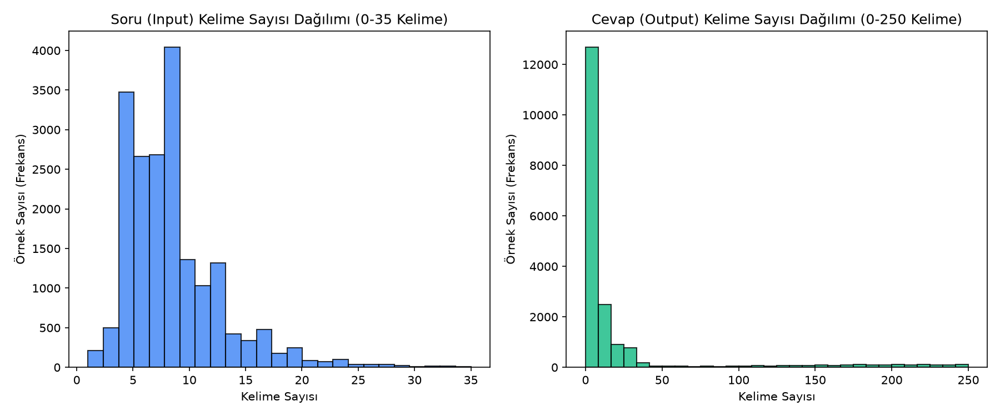
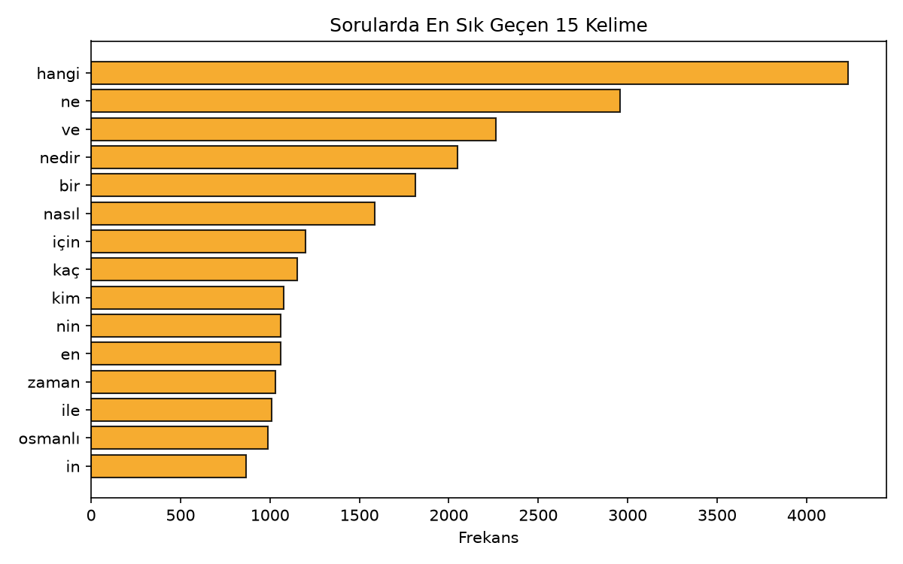

# Türkçe Transformer Tabanlı Diyalog Ajanı (Baseline & EDA)


> **🇬🇧 English Summary:** An end-to-end **Turkish Question-Answering & Multi-Turn Dialogue System** developed for the *Introduction to Deep Learning* course at **Atatürk University (Department of AI & Data Engineering)**. Built on the `sixfingerdev/turkish-qa-multi-dialog-dataset` (19,431 deduplicated QA pairs, 58,426 vocabulary size), this repository implements a custom Turkish text normalization pipeline, Exploratory Data Analysis (EDA), a **TF-IDF + Cosine Similarity Retrieval Baseline** with sublinear TF scaling and bigrams, and comprehensive quantitative evaluation using **BLEU-1/2/4**, **ROUGE-1/2/L**, and qualitative error analysis.

**Öğrenci:** Mustafa Can Akkuş (240711004)  
**Bölüm:** Atatürk Üniversitesi — Yapay Zeka ve Veri Mühendisliği  
**Ders:** Derin Öğrenmeye Giriş  
**Öğretim Üyesi:** Prof. Dr. Afshin Ebrahimi  

Bu proje, `sixfingerdev/turkish-qa-multi-dialog-dataset` veri seti üzerinde Türkçe soru-cevap ve diyalog üretimi gerçekleştirmek amacıyla hazırlanmıştır. Şu anki aşama **TF-IDF + Kosinüs Benzerliği Tabanlı Bilgi Getirme (Retrieval) Referans Modelini (Baseline)**, veri ön işleme adımlarını, Keşifsel Veri Analizini (EDA) ve değerlendirme metriklerini (BLEU, ROUGE, Hata Analizi) içermektedir.

---

## 📊 Keşifsel Veri Analizi (EDA) ve Model Sonuçları

### Veri Seti İstatistikleri
| Metrik | Değer |
| :--- | :--- |
| **Toplam Benzersiz Örnek Sayısı** | `19,431` |
| **Toplam Kelime Haznesi (Vocabulary)** | `58,426` benzersiz kelime |
| **Ortalama Soru Uzunluğu** | `8.69` kelime |
| **Ortalama Cevap Uzunluğu** | `29.01` kelime |
| **Veri Bölünmesi (Train / Val / Test)** | `%80` / `%10` / `%10` (Veri sızıntısı önlenmiş) |

### EDA Görselleştirmeleri
<p align="center">
  
  
</p>

### TF-IDF + Kosinüs Benzerliği Baseline Performansı
| Veri Seti | BLEU-1 | BLEU-2 | BLEU-4 | ROUGE-1 | ROUGE-2 | ROUGE-L | Ort. Kosinüs Benzerliği |
| :--- | :---: | :---: | :---: | :---: | :---: | :---: | :---: |
| **Doğrulama (Validation)** | `%11.14` | `%7.40` | `%3.00` | `%13.26` | `%6.27` | `%12.37` | `%61.24` |
| **Test Seti (Final)** | `%11.10` | `%7.03` | `%2.32` | `%13.36` | `%5.84` | `%12.48` | `%61.25` |

---

## 1. Klasör Yapısı

```text
turkce-diyalog-projesi/
├── README.md
├── requirements.txt
├── data/                  # Ham veri (data.json) ve bölünmüş train/val/test setleri
├── notebooks/             # Deneysel çalışmalar için klasör
├── src/
│   ├── preprocessing.py   # Türkçe küçük harf dönüşümü, temizlik, %80/%10/%10 bölme ve EDA
│   ├── model.py           # TF-IDF + Kosinüs Benzerliği Baseline model sınıfı
│   ├── train.py           # Baseline modelini eğitip models/ klasörüne kaydeden betik
│   ├── evaluate.py        # BLEU (1,2,4), ROUGE (1,2,L) ve 5 doğru / 5 yanlış örnek analizi
│   └── inference.py       # Eğitilmiş modelle canlı sohbet veya demo testi
├── models/                # Eğitilmiş model dosyaları (tfidf_baseline.pkl)
├── results/               # EDA grafikleri, metrik tabloları ve hata analizi çıktıları
└── report/                # Proje raporları
```

---

## 2. Tekrarlanabilirlik Bilgileri (Reproducibility)

* **Python Sürümü:** Python 3.14 (veya Python 3.9+)
* **Kütüphane Sürümleri:** `scikit-learn 1.9.0`, `numpy 2.5.1`, `matplotlib 3.11.2`, `joblib 1.5.3`
* **Donanım:** CPU (TF-IDF baseline modeli CPU üzerinde saniyeler içinde çalışmaktadır)
* **Sabit Tohum Değeri (Random Seed):** `42`
* **Baseline Hiperparametreleri:**
  * `ngram_range = (1, 2)` (Unigram ve Bigram özellikler)
  * `max_features = 25000` (Kelime haznesi sınırı)
  * `sublinear_tf = True` (Logaritmik terim frekansı ölçekleme)
  * Veri Bölünmesi: `%80 Eğitim`, `%10 Doğrulama`, `%10 Test` (Tekrar eden sorular veri sızıntısını önlemek için bölünmeden önce temizlenmiştir)

---

## 3. Projeyi Çalıştırma Adımları

1. **Gerekli Kütüphanelerin Kurulumu:**
   ```bash
   pip install -r requirements.txt
   ```

2. **Veri Ön İşleme ve Keşifsel Veri Analizi (EDA):**
   ```bash
   python src/preprocessing.py
   ```
   *(Bu adım `data.json` verisini temizler, `%80/%10/%10` olarak `data/` klasörüne böler ve `results/` klasörüne EDA grafiklerini kaydeder.)*

3. **TF-IDF Baseline Modelini Eğitme:**
   ```bash
   python src/train.py
   ```
   *(Modeli eğitim verisi üzerinde kurar ve `models/tfidf_baseline.pkl` olarak kaydeder.)*

4. **Değerlendirme (BLEU, ROUGE) ve Hata Analizi:**
   ```bash
   python src/evaluate.py
   ```
   *(Doğrulama ve Test setleri üzerinde BLEU-1/2/4 ve ROUGE-1/2/L skorlarını hesaplar; 5 doğru ve 5 hatalı örneği `results/` klasörüne yazar.)*

5. **Soru-Cevap Testi (Çıkarım / Sohbet):**
   * Örnek sorularla hızlı test için:
     ```bash
     python src/inference.py --demo
     ```
   * Terminalden canlı sohbet etmek için:
     ```bash
     python src/inference.py
     ```
